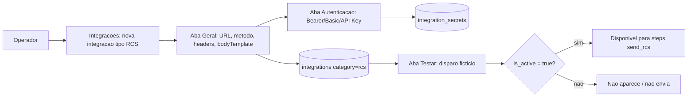
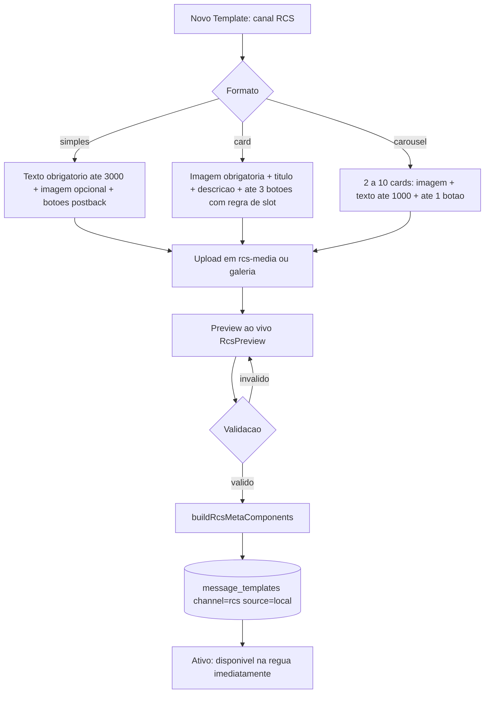
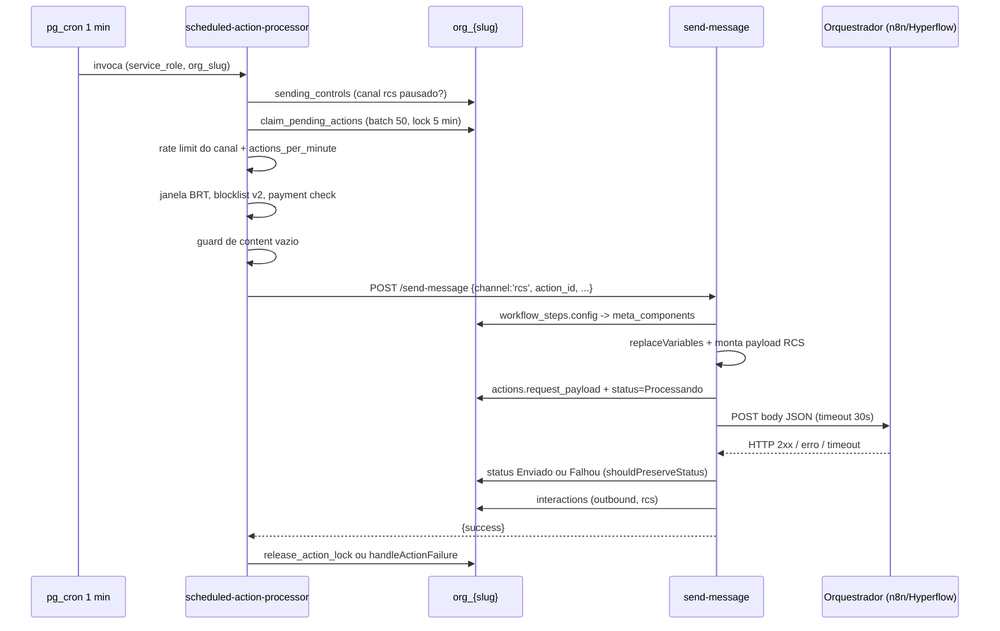

# RCS — Documentação Técnica e Funcional

> Como o canal **RCS** (Rich Communication Services) funciona hoje na Torre de Controle: do template rico (simples, card, carrossel) ao disparo pela régua/campanha, à entrega via webhook da integração e à atualização de status da ação.
>
> **Escopo desta doc:** o que está em `prod` no momento da escrita (28 de julho de 2026). Tudo aqui foi reconciliado contra o código do repositório. Onde o código não prova um número, um SLA ou um comportamento externo, a doc diz explicitamente que não sabemos — não há número inventado.
>
> **Versão de negócio:** [RCS — Visão Executiva](./rcs-visao-executiva.md) (CTO/Diretoria: o que já funciona, autonomia da operação, limitações e decisões pendentes).
>
> Guias relacionados: [Ações e Status](./acoes-e-status.md) · [Campanhas e Réguas](./campanhas-e-reguas.md) · [Integrações](./integracoes.md) · [Variáveis e Templates](./variaveis-e-templates.md) · [Webhooks de Pagamento](./webhooks-pagamento.md) · [Observabilidade](./observabilidade.md)

---

## 1. Objetivo

### 1.1 Contexto

Antes do RCS, todo contato de cobrança em canal de mensageria saía da Torre como **texto puro**: WhatsApp (via webhook/gateway próprio), SMS, e-mail e voz. Os limites desse cenário:

- **Sem elementos visuais nativos.** O SMS é texto puro de 160 caracteres por segmento (`src/components/reguas-cobranca/config-forms/ChannelConfigForm.tsx:118`, aviso de múltiplas partes). Não havia como entregar imagem, título e botões de ação num único elemento clicável na caixa de mensagens nativa do aparelho.
- **Sem botão de ação padronizado.** Para levar o devedor ao pagamento, a única saída era colar um link cru no corpo do texto — com todos os problemas de legibilidade e de confiança que um link solto num SMS carrega.
- **Sem canal rico independente do WhatsApp.** O único canal com estrutura (template Meta/HSM com header/body/botões) era o WhatsApp, que depende de aprovação da Meta, de janela de sessão e de o cliente ter o app.
- **Sinal de intenção pobre.** Em texto puro, a única forma de o cliente sinalizar "quero pagar" ou "quero falar com atendente" é escrever e ser interpretado. Não havia um evento estruturado de clique por categoria.

**Necessidade de negócio:** ter um canal nativo do aparelho (não depende de instalar app), com identidade visual, texto formatado e **botões que carreguem a intenção do cliente** (confirmar pagamento, pagar, enviar comprovante, falar com atendente), reaproveitando toda a máquina de cobrança já existente (réguas, filtros, dedup, blocklist, janela de envio, status de ação).

### 1.2 Objetivos

**De negócio**

- Oferecer um canal rico de cobrança que chegue ao aplicativo de mensagens nativo do Android, sem exigir app adicional.
- Aumentar a clareza da mensagem (imagem + título + descrição) e encurtar o caminho até o pagamento (botão de link direto ou postback de intenção).
- Capturar intenção estruturada do cliente pelos botões de postback (4 categorias: confirmação de pagamento, realizar pagamento, enviar comprovante, falar com atendente).

**Técnicos**

- Tratar RCS como **mais um canal** da arquitetura existente, e não como um subsistema paralelo: mesmo `actions`, mesmos 12 status canônicos, mesmo `scheduled-action-processor`, mesmo `send-message`, mesma janela/rate-limit/blocklist.
- Persistir a estrutura rica na **coluna JSONB `meta_components`** já existente em `message_templates` (a mesma usada pelos templates Meta), sem criar tabela nova.
- Entregar o conteúdo ao orquestrador externo (n8n/Hyperflow) em **campos planos e arrays paralelos**, para o flow conseguir rotear sem nós de código.

**Benefícios esperados**

Ainda não temos métrica consolidada para isso. Não há, no repositório, nenhum relatório, KPI ou análise que compare conversão/custo de RCS contra os demais canais.

### 1.3 Escopo

**Faz parte (implementado e verificável no código):**

| Item | Onde |
|------|------|
| Canal `rcs` como categoria de integração | CHECK `valid_integration_category` em `org_*.integrations` |
| Bucket público de mídia `rcs-media` (upload + galeria) | `supabase/migrations/20260707120000_squash_release_1_1_0_iaf3989.sql` (bloco `20260623100000_add_rcs_channel.sql`), `src/hooks/useUploadRcsImage.ts` |
| Template RCS em 3 formatos (simples, card, carrossel) | `src/components/message-templates/rcs-meta.ts`, `RcsCardBuilder.tsx`, `RcsCarouselBuilder.tsx` |
| Pré-visualização do card no builder e na régua | `src/components/message-templates/RcsPreview.tsx` |
| Step `send_rcs` em régua e em broadcast | `src/types/reguas-cobranca.ts:129`, `src/components/campaigns/BroadcastAddStepDialog.tsx:74` |
| Mapeamento `send_rcs → rcs` nos executores | `supabase/functions/campaign-executor/index.ts:1134`, `supabase/functions/broadcast-processor/index.ts:759` |
| Montagem e envio do payload RCS | `supabase/functions/send-message/index.ts:1758-1925` (payload) e `:628-747` (`sendWebhook`) |
| Custo por canal `rcs` | `src/lib/cost-calculator.ts:7` + tabela `channel_costs` |

**NÃO faz parte (não existe no sistema hoje):**

- **Criação/cadastro do agente RCS (RBM) pela Torre.** Não há tela, tabela, EF ou API na Torre que crie, registre ou publique um agente RCS junto ao provedor/Google. O agente é provisionado fora da Torre; a Torre só conhece a **integração HTTP** que aponta para o orquestrador. Ver §5.1 e §8.1.
- **Fluxo de aprovação/homologação de template RCS.** O template RCS é 100% **local** (`source='local'`): é salvo e já fica disponível. Não há `meta_status`, submissão nem retorno de aprovação para RCS (isso existe só para templates Meta/WhatsApp, via `sync-meta-templates`). Ver §5.2.
- **Versionamento de template.** `message_templates` não tem coluna de versão nem histórico; editar sobrescreve.
- **Recebimento de mensagem RCS de texto livre do cliente dentro da Torre.** Não há rota, tabela ou parser específico de inbound RCS. O que existe é o callback genérico de status de ação (§8.7).
- **Fallback automático RCS → SMS/WhatsApp.** Não há nenhuma lógica de fallback de canal no `send-message` nem no processor. Se o aparelho não suporta RCS, o desfecho depende inteiramente do orquestrador externo. Ver §18.
- **Ingestão por arquivo (CSV/Excel/SFTP/bucket) específica de RCS.** Não se aplica — ver §6.3.

---

## 2. Visão Geral da Solução

```
┌────────────────────────── TORRE DE CONTROLE (React + Supabase) ──────────────────────────┐
│                                                                                           │
│  Templates RCS            Réguas / Campanhas              Integração RCS                  │
│  message_templates        workflow_steps                  integrations                    │
│  channel='rcs'            step_type='send_rcs'            category='rcs'                  │
│  meta_components JSONB    config.meta_components          config: url/method/             │
│  (FORMAT/HEADER/TITLE/    config.template_id                      headers/bodyTemplate    │
│   BODY/BUTTONS/CAROUSEL)  config.message (fallback)       integration_secrets (auth)      │
│         │                        │                                 │                      │
│  Storage: rcs-media              │                                 │                      │
│  (imagens públicas, 2MB)         │                                 │                      │
│                                  ▼                                 │                      │
│              Pipeline v2 (6 RPCs) ou broadcast-processor           │                      │
│                                  │                                 │                      │
│                                  ▼                                 │                      │
│                    actions (channel='rcs', status='Pendente')      │                      │
│                                  │                                 │                      │
│                                  ▼                                 │                      │
│      scheduled-action-processor  (cron 1 min)                      │                      │
│      janela · pausa · rate limit · blocklist · payment check       │                      │
│                                  │                                 │                      │
│                                  ▼                                 ▼                      │
│                        send-message  ── resolve {{variáveis}} + monta payload RCS         │
└──────────────────────────────────┬────────────────────────────────────────────────────────┘
                                   │  HTTP POST (JSON), timeout 30 s, AbortController
                                   ▼
                    ┌──────────────────────────────┐
                    │  Orquestrador externo         │   flow condicional "Canal: RCS?"
                    │  (n8n / Hyperflow)            │   lê rcs="true", rcs_format,
                    │                               │   image/titulo/botoes[]/cards_*[]
                    └──────────────┬────────────────┘
                                   │
                                   ▼
                    ┌──────────────────────────────┐
                    │  Plataforma RCS / RBM         │  <!-- TODO: confirmar com gestor —
                    │  (provedor + operadora)       │       qual provedor/agregador RBM
                    └──────────────┬────────────────┘       está por trás do Hyperflow -->
                                   ▼
                        Aparelho Android do cliente
                                   │
                                   │  callback de status
                                   ▼
              PATCH /api/actions/:id  ou  POST /api/webhooks/communication
                                   │
                                   ▼
                     actions.status (12 status canônicos)
```

**Componentes**

| Componente | O que é | Papel no RCS |
|------------|---------|--------------|
| **Builder de template** (`RcsCardBuilder`, `RcsCarouselBuilder`) | UI React | Monta o card (imagem/título/texto/botões) e serializa para `meta_components` |
| **Bucket `rcs-media`** | Storage Supabase público | Guarda as imagens dos cards; a URL pública vai dentro do `meta_components` |
| **`message_templates`** | Tabela org | Persiste o template RCS (`channel='rcs'`, `source='local'`) |
| **`workflow_steps`** | Tabela org | Step `send_rcs`: guarda `integration_id`, `template_id`, cópia do `meta_components` e o texto de fallback (`message`) |
| **Pipeline v2 / broadcast-processor** | RPCs + EF | Decidem QUEM recebe e criam a `action` com `channel='rcs'` |
| **`scheduled-action-processor`** | EF (cron 1 min) | Decide QUANDO enviar: janela, pausa, rate limit, blocklist, payment check, retry/DLQ |
| **`send-message`** | EF | Resolve `{{variáveis}}`, monta o payload RCS e faz o POST na integração |
| **Integração RCS** | Linha em `integrations` + segredos | URL/método/headers/bodyTemplate + credenciais do orquestrador |
| **Orquestrador externo (n8n/Hyperflow)** | Fora da Torre | Recebe o payload plano e monta a mensagem RCS na plataforma RBM |
| **Callback de status** | Rotas da EF `api` | Devolve `delivered/read/replied/failed/...` → status canônico da ação |

---

## 3. Definições

| Termo | Significado |
|-------|-------------|
| **RCS** | *Rich Communication Services* — sucessor do SMS, mensagem rica (imagem, título, botões) entregue no app de mensagens nativo do aparelho. Na Torre é o canal `rcs`. |
| **RBM** | *RCS Business Messaging* — a modalidade empresarial do RCS, em que uma marca (agente) envia mensagens a usuários. A Torre não fala RBM diretamente: fala com um orquestrador que fala RBM. |
| **Agente RCS** | A identidade da marca no RCS (nome, logo, verificação). **Não é criado nem versionado pela Torre** — ver §5.1. |
| **Template (RCS)** | Linha em `message_templates` com `channel='rcs'` e `source='local'`, cuja estrutura rica mora no JSONB `meta_components`. |
| **`meta_components`** | Coluna JSONB de `message_templates` (e cópia em `workflow_steps.config`) que descreve o conteúdo rico. Nomeada assim porque nasceu para templates Meta/WhatsApp; o RCS reaproveita com os tipos locais `FORMAT`, `TITLE` e `CAROUSEL`. |
| **Formato** | `simples` (texto + imagem opcional + respostas rápidas), `card` (imagem + título + descrição + até 3 botões) ou `carousel` (2 a 10 cards). |
| **Postback** | Botão que não abre link: devolve ao flow a **intenção** do cliente. 4 categorias: `confirmacao_pagamento`, `realizar_pagamento`, `comprovante`, `atendente`. |
| **`botoes_pattern`** | String derivada do tipo+ordem dos botões (`p`=postback, `u`=url) — ex.: `"ppu"`. Serve para o flow rotear sem nó de código. |
| **Arrays paralelos** | Contrato de payload em que cada atributo do carrossel vira um array próprio alinhado por índice (`cards_image[i]`, `cards_titulo[i]`, …), em vez de um array de objetos. |
| **Campanha** | `campaigns` — liga réguas a um gatilho e a uma janela de envio (`active_days`, `start_time`, `end_time`, `actions_per_minute`). |
| **Régua (workflow)** | Sequência de steps de cobrança; cada step tem canal, conteúdo e faixa de dias de atraso. |
| **Step** | `workflow_steps` — um passo da régua. O passo de RCS tem `step_type='send_rcs'`. |
| **Título** | `titles` — a dívida individual. O sistema é **title-centric**: avalia títulos, não contatos. |
| **`days_overdue`** | Dias de atraso do título; **suporta negativos** (cobrança preventiva D-7, D-1). |
| **Ação** | `actions` — unidade de entrega (1 mensagem para 1 contato/título) com `channel='rcs'` e um dos 12 status canônicos. |
| **`disposition`** | Estado do candidato dentro do Pipeline v2 (`pending` → `fetched` → `matched`/`selected` → `action_created`, ou `excluded_*`). |
| **Org schema** | Multi-tenancy por schema: cada organização vive em `org_{slug}`. Templates, integrações, steps e ações são por org. |
| **Fallback (texto)** | O campo `message` do step (`action.content`) — texto simples que acompanha o payload rico. No carrossel, é fallback secundário usado pelo orquestrador se o conteúdo do card falhar. |
| **Fallback (canal)** | Troca automática de RCS por outro canal quando o aparelho não suporta. **Não existe na Torre** — ver §18. |

---

## 4. Arquitetura

### 4.1 Arquitetura lógica

```
   AUTORIA                    DECISÃO                      ENTREGA                 FEEDBACK
┌────────────┐          ┌──────────────────┐        ┌──────────────────┐    ┌────────────────┐
│ Template   │          │ Pipeline v2      │        │ processor        │    │ Callback       │
│ RCS        │──┐       │ (6 RPCs)         │        │ (janela/limites) │    │ status         │
│ (3 formatos│  │       │  ou              │───────▶│        │         │───▶│                │
│  + imagem) │  │  ┌───▶│ broadcast-       │        │        ▼         │    │ PATCH /actions │
└────────────┘  ├──┘    │ processor        │        │  send-message    │    │ POST /webhooks │
┌────────────┐  │       └──────────────────┘        │  (payload RCS)   │    │  /communication│
│ Step       │──┘         cria actions               └────────┬─────────┘    └───────┬────────┘
│ send_rcs   │            channel='rcs'                       │ HTTP POST            │
│ (régua)    │            status='Pendente'                   ▼                      ▼
└────────────┘                                        orquestrador externo     actions.status
┌────────────┐                                        (n8n / Hyperflow)
│ Integração │───────────────── url/headers/auth ────────────▶
│ rcs        │
└────────────┘
```

Três invariantes lógicas importantes:

1. **A estrutura rica só existe em dois lugares:** no template (`message_templates.meta_components`) e na cópia congelada dentro do step (`workflow_steps.config.meta_components`). O `send-message` lê preferencialmente a cópia do step; só se ela não existir é que busca o template por `config.template_id` (`send-message/index.ts:1778-1794`).
2. **A `action` não guarda o card.** Ela guarda `content` (o texto de fallback já resolvido), `recipient`, e — depois de montado — o `request_payload` completo enviado à integração. O card é remontado a cada envio.
3. **O RCS não tem caminho próprio de envio.** Ele passa pela mesma função de webhook genérico dos demais canais HTTP (`sendWebhook`), com um bloco de enriquecimento específico.

### 4.2 Arquitetura física

| Camada | Tecnologia | Detalhe relevante ao RCS |
|--------|-----------|--------------------------|
| Frontend | React 19 + Vite + Tailwind + shadcn/ui | Builders, preview, seleção de template na régua |
| Banco | PostgreSQL (Supabase), **schema por organização** (`org_{slug}`) | `message_templates`, `workflow_steps`, `integrations`, `integration_secrets`, `actions`, `channel_costs`, `interactions` |
| Storage | Supabase Storage, bucket **público** `rcs-media` | Limite 2 MB, MIME `image/gif`, `image/jpeg`, `image/png`; 4 policies (INSERT/UPDATE/DELETE para `authenticated`, SELECT para `public`) |
| Edge Functions | Deno (Supabase Functions) | `scheduled-action-processor`, `send-message`, `campaign-executor`, `broadcast-processor`, `api` |
| Agendamento | `pg_cron` | `scheduled-action-processor` roda a cada minuto; `campaign-scheduler` a cada 5 min |
| Fila | **Não há broker.** A "fila" é a própria tabela `actions` com `status='Pendente'` + claim atômico com lock (`locked_by`/`locked_until`) | `claim_pending_actions` / `release_action_lock` / `process_action_failure` |
| DLQ | Tabela de dead-letter alimentada por `moveToDeadLetterQueue()` | Ação vira `Falha Permanente` |
| Retry de callback | `webhook_retry_queue` + EF `process-webhook-retries` (cron 1 min, backoff 30 s → 2 min → 8 min → 30 min → 2 h, máx. 5) | Compartilhado com os demais canais |

**Parâmetros de execução do processor** (`supabase/functions/scheduled-action-processor/index.ts:586-597`):

| Parâmetro | Default | Observação |
|-----------|---------|------------|
| `batch_size` | 50 | Ações reivindicadas por invocação |
| `lock_duration_minutes` | 5 | TTL do lock do worker |
| `concurrency_limit` | 5 | Clampado entre 1 e 10 |
| `actions_per_minute` | 50 (por campanha, se não configurado) | Vem de `campaigns.actions_per_minute` |
| `max_retries` | 3 (coluna `actions.max_retries`) | Ao esgotar → DLQ / `Falha Permanente` |

### 4.3 Integrações

#### 4.3.1 Torre → Orquestrador externo (n8n / Hyperflow) — o envio do RCS

| Aspecto | Valor real |
|---------|-----------|
| **Objetivo** | Entregar o conteúdo RCS já resolvido para que o orquestrador monte e dispare a mensagem na plataforma RBM |
| **Protocolo** | HTTP, método configurável (`config.method`, default `POST`), corpo JSON |
| **URL** | `config.url` ou `config.webhookUrl` da integração (`send-message/index.ts:638`) |
| **Autenticação** | Definida na integração: Bearer, Basic, API Key em header, ou nenhuma. As credenciais ficam em `integration_secrets` e são mescladas no `config` em runtime — **nunca no `config` cru** |
| **Headers** | `Content-Type: application/json` + os headers configurados (inclui o `x-org-slug: {{org.slug}}` travado pela UI de integrações) |
| **Timeout** | **30 s**, via `AbortController` (`send-message/index.ts:703-705`) — folga dentro do teto de ~60 s da Edge Function |
| **Tratamento de erro** | Corpo lido **uma única vez** como texto e só então tentado `JSON.parse` (evita "Body already consumed", que já causou envio OK marcado como falha → retry → duplicata). `success = response.ok`. Timeout devolve `"Webhook timeout after 30s"` |
| **Retentativa** | Não há retry dentro do `send-message`. Quem retenta é o `scheduled-action-processor` (`handleActionFailure`), respeitando `max_retries` |
| **Roteamento** | O `switch (routingSlug)` cai em `custom-webhook` / `webhook-whatsapp`, ou no `default` quando `config.url` existe. Se não houver `config.url` e o slug não for implementado → **HTTP 501** |

#### 4.3.2 Orquestrador → Torre — callback de status

| Aspecto | Valor real |
|---------|-----------|
| **Objetivo** | Avançar o status da ação depois do envio |
| **Rotas** | `PATCH /api/actions/:id` (campos permitidos em `api/routes/actions.ts:163-193`) e `POST /api/webhooks/communication` (`api/routes/webhooks.ts:347+`) |
| **Autenticação** | `x-api-key` (chave universal) + `x-org-slug` **obrigatório**. Ausente → 400; org inexistente → 404; key inativa → 403. Há anti-spoofing: `body.org_slug` divergente do autenticado → **403** |
| **Correlação** | `PATCH` por `id` da ação; o webhook `communication` casa por `message_id` = `actions.external_id` |
| **Tradução de status** | `resolveActionStatus()` converte o inglês do provedor para o canônico em português |
| **Erro** | Se o UPDATE falhar, o evento é enfileirado em `webhook_retry_queue` e reprocessado pela EF `process-webhook-retries` |
| **Timeout/retentativa** | 30 s por tentativa; backoff 30 s → 2 min → 8 min → 30 min → 2 h, máx. 5 tentativas |

#### 4.3.3 Torre → Supabase Storage (`rcs-media`)

| Aspecto | Valor real |
|---------|-----------|
| **Objetivo** | Hospedar a imagem do card e devolver uma URL pública que o provedor consiga baixar |
| **Protocolo** | SDK `supabase.storage` (HTTP) direto do navegador |
| **Autenticação** | JWT do usuário logado (policy `authenticated` para INSERT/UPDATE/DELETE) |
| **Path** | `{organization_id}/rcs-{timestamp}.{ext}`, `upsert: true`, `cacheControl: 3600` |
| **Validação** | `validateRcsImage()` — MIME em `[image/gif, image/jpeg, image/png]` e tamanho ≤ 2 MB (o bucket também impõe os dois no servidor) |
| **Erro** | Falha → `logError()` + toast "Erro no upload"; a função devolve `null` e o card não recebe imagem |
| **Timeout** | Não há timeout explícito no cliente — o do SDK/navegador |

#### 4.3.4 Não-integrações

- **Google Jibe / operadora:** a Torre **não** fala com o Google nem com a operadora. Esse trecho é responsabilidade do orquestrador/provedor. <!-- TODO: confirmar com gestor — nome do provedor RBM, se há Jibe no caminho, e quem responde por incidente nessa ponta -->
- **API oficial de RBM:** não há cliente, credencial nem chamada a API RBM no repositório.

---

## 5. Regras de Negócio

### 5.1 Criação do Agente

**Não se aplica à Torre.** Não existe entidade "agente RCS" no sistema: nenhuma tabela, tela, EF ou rota cria, publica ou versiona um agente/marca RCS. O que o operador cria na Torre é uma **integração** de categoria `rcs` (`integrations.category='rcs'`), que aponta para a URL do orquestrador. Todo o cadastro do agente junto ao provedor/Google acontece fora do sistema.

<!-- TODO: confirmar com gestor — quem provisiona o agente RCS, qual o processo de verificação da marca, prazos e onde ficam registradas as credenciais do agente -->

Regras que a Torre de fato impõe à integração:

- `category` deve estar no CHECK `valid_integration_category` — `rcs` foi adicionado em 23 de junho de 2026 para **todos** os schemas `org_%` existentes, e o template de org nova (`supabase/templates/org_schema_template.sql`) já nasce com ele.
- Integração com `is_active = false` **não envia** (o `send-message` só usa ativas).
- Credenciais vão para `integration_secrets`, nunca para `integrations.config`.

### 5.2 Templates

**Criação** — menu Templates → "Novo Template" → Canal = **RCS**. O diálogo troca o editor de texto por um seletor de **Formato** + o builder correspondente (`TemplateDialog.tsx:224-249`).

**Regras de conteúdo por formato** (`src/components/message-templates/rcs-meta.ts`):

| Formato | Imagem | Título | Texto | Botões | Validação para salvar |
|---------|--------|--------|-------|--------|------------------------|
| `simples` | opcional | não tem | obrigatório, até **3000** caracteres | até 3, **só postback** | `body` preenchido |
| `card` | **obrigatória** | opcional | obrigatório (é a "descrição") | até 3, com regra de slot | `imageUrl` **e** `body` preenchidos |
| `carousel` | obrigatória **em cada card** | opcional por card | obrigatório por card, até **1000** caracteres | até **1** por card | 2 a 10 cards; todo card com imagem e texto |

**Regra de slot dos botões** (formato `card`, `rcsButtonSlot`):

| Qtd. de botões | Posição 1 | Posição 2 | Posição 3 |
|----------------|-----------|-----------|-----------|
| 1 | livre (URL ou postback) | — | — |
| 2 | postback | livre | — |
| 3 | postback | postback | **URL (fixo)** |

No formato `simples`, **todos** os botões são postback (`rcsButtonSlotFor`). No carrossel, o botão de URL só é permitido se houver no máximo 2 cards **ou** se for o **último** card (`rcsCarouselUrlAllowed`).

**Outros limites:** texto de botão ≤ **20** caracteres (truncado na serialização); no máximo **3** botões; no máximo **1 botão de URL** por mensagem — é essa regra que justifica o campo plano `url` no payload.

**Categorias de postback** (a intenção que chega ao flow): `confirmacao_pagamento`, `realizar_pagamento`, `comprovante`, `atendente`. Templates antigos com as categorias legadas `pagamento`/`humano` são migrados na leitura (`LEGACY_CATEGORY` em `rcs-meta.ts:88-91`) — não há migration de dados; a conversão é em tempo de parse.

**Variáveis:** o texto, o título e o valor do botão de URL aceitam `{{variáveis}}` (ex.: `{{contact.name}}`, `{{title.current_value}}`, `{{pix_link}}`). Ao salvar, as variáveis detectadas são extraídas do corpo (formato simples/card) ou da concatenação de título+texto+botões de todos os cards (carrossel) e gravadas em `variables`.

**Aprovação / publicação / versionamento:** não existem para RCS. O template é `source='local'`, fica disponível assim que salvo com `is_active = true`, e editar sobrescreve (sem histórico). Templates inativos não aparecem na seleção das réguas.

**Aviso operacional (imagem-only):** no formato `simples` com imagem preenchida e **texto vazio**, o builder exibe um alerta — mensagens só com imagem **não permitem rastrear falha de entrega** (ex.: aparelho sem suporte a RCS). O aviso não bloqueia o salvamento (`RcsCardBuilder.tsx:57` e `:172-182`).

### 5.3 Campanhas

O RCS **não tem regra de segmentação própria**: ele herda 100% do motor de campanhas.

- **Quem entra:** filtros e portfolios das réguas (`campaign_pipeline_resolve_contacts`), expandidos para títulos (`fetch_titles`) com a whitelist estrita de status cobráveis `('Disponivel','Expirado','Recomprado')`.
- **Qual step dispara:** o título é cruzado com os steps pelo `days_overdue` (`match_titles`), que suporta valores negativos (D-7, D-1).
- **Exclusões:** blocklist v2 nos 3 níveis (contato/contrato/título), cooldown, `same_step`, `higher_priority` (`apply_rules`), e dedup global entre campanhas (`cross_dedup`).
- **Dedup por contato vs. contrato:** RCS é **canal de comunicação**, então faz dedup **por contato** (1 mensagem por contato por canal). Só `negativation`/`notification` fazem dedup por contrato.
- **Custo:** `send_rcs → rcs` em `STEP_TYPE_TO_CHANNEL`; o valor unitário vem de `channel_costs` (linha com `channel='rcs'`). **RCS não está em `CHANNELS_WITH_AI`** — diferente de WhatsApp e voz, não soma custo de IA automático na estimativa.
- **Broadcast:** o step `send_rcs` também existe no diálogo de broadcast e o `broadcast-processor` mapeia `send_rcs → rcs`. Sem esse mapeamento (situação anterior a 29 de junho de 2026), a ação nascia com canal desconhecido.

Detalhes completos do motor: [campanhas-e-reguas.md](./campanhas-e-reguas.md).

### 5.4 Envio

Tudo decidido pelo `scheduled-action-processor`, igual aos demais canais:

| Regra | Comportamento |
|-------|---------------|
| **Pausa** | `sending_controls` com `is_paused=true` para o canal `rcs` pula todas as ações de RCS do ciclo (lock liberado, status inalterado). `channel='all'` pausa o ciclo inteiro. Falha ao ler a tabela = **fail-closed** (não envia) |
| **Data bloqueada** | `blocked_dates` (feriado/evento) ativa para a data BRT de hoje ⇒ **o ciclo inteiro é pulado**. Falha ao ler = fail-closed (HTTP 503) |
| **Janela de dias** | `campaigns.active_days`; se NULL/vazio, fallback **seg–sáb** (`[1,2,3,4,5,6]`). Domingo é opt-in |
| **Janela de horário** | `start_time`/`end_time` da campanha; default **08:00–18:00**, avaliado em **BRT** via `_shared/brasilia-time.ts` |
| **Fora da janela** | A ação volta para `Pendente` (não falha, não perde) |
| **Rate limit por canal** | RPC `check_and_increment_rate_limit(p_channel, p_count)` — checado 1× por lote e de novo 1× por ação. Estourou → lock liberado, ação volta a `Pendente` |
| **Rate limit por campanha** | `actions_per_minute` (default 50): o excedente do ciclo tem o lock liberado |
| **Concorrência** | `processWithConcurrency` com limite 5 (1–10) |
| **Prioridade** | `actions.priority` / `priority_order` na ordenação da fila |
| **Retentativas** | `max_retries` = 3 (coluna). Via RPC `process_action_failure`; no fallback local, backoff exponencial `2^n` minutos **limitado a 960 s (16 min)**. Ao esgotar → DLQ + `Falha Permanente` |
| **Guarda de conteúdo vazio** | `action.content` vazio → ação vai direto para `Falhou` **antes** de chamar o `send-message` (ver §18, é o principal footgun do carrossel) |
| **Blocklist e payment check** | Idênticos aos demais canais; ver [acoes-e-status.md](./acoes-e-status.md) |

### 5.5 Recebimento

O que a Torre trata hoje é **status de ação**, não conversa RCS:

| Evento recebido | Status canônico resultante |
|-----------------|---------------------------|
| `message_delivered` | `Interagiu` (+ `delivered_at`) |
| `message_read` | `Interagiu` (+ `read_at`) |
| `message_replied` | `Respondido` (+ `reply_content`) — exibido na UI como "Solicitou Atendimento" |
| `message_failed` | `Falhou` (+ `error_message`) |
| `ignored` / `skipped` (via `PATCH`) | `Em Atendimento` |
| `duplicate` (via `PATCH`) | `Duplicado` |

**Respostas automáticas e transferência para humano acontecem fora da Torre.** O clique num botão de postback chega ao orquestrador carregando a categoria da intenção (`botoes_tipo[i]`); é o flow que decide responder, transferir ou abrir atendimento. A Torre só vê o reflexo disso quando o flow chama o callback. O texto de ajuda do builder afirma que as 4 categorias de postback "transferem o atendimento" (`RcsCardBuilder.tsx:207-208`) — a implementação desse comportamento é do flow, não do repositório.

<!-- TODO: confirmar com gestor — qual é exatamente o comportamento do flow por categoria de postback (confirmacao_pagamento, realizar_pagamento, comprovante, atendente) e se todas realmente abrem atendimento humano -->

### 5.6 Tratamento de erros

| Cenário | O que acontece hoje |
|---------|--------------------|
| **Template sem `meta_components`** (step antigo/ sem template) | `rcsComponents` fica `null` → o payload sai com `rcs="true"`, `rcs_format="simples"` e todos os campos ricos **vazios** (`image:""`, `botoes:[]`, `qtd_botoes:0`, `botoes_pattern:""`). O envio prossegue como texto. É deliberado: o flow nunca quebra em `{{flow.botoes[n]}}` |
| **Template referenciado inexistente** | A busca por `config.template_id` devolve nulo; recai no caso acima |
| **Conteúdo vazio (não-carrossel)** | `send-message` responde **400** `Empty message content` e marca a ação `Falhou` + `failed_at`. Antes disso, o processor já barra por `action.content` vazio |
| **Carrossel sem `message`** | O guard de mensagem vazia do `send-message` é **dispensado** se o `stepConfig.meta_components` tiver `FORMAT='carousel'` com ≥1 card. Atenção: o guard do **processor** continua valendo (§18) |
| **Falha de autenticação na integração** | O provedor devolve 401/403; `response.ok=false` → `SendResult.success=false` → `Falhou` → retry/DLQ |
| **Timeout (>30 s)** | `AbortError` → erro `"Webhook timeout after 30s"` → `Falhou` → retry |
| **Integração sem URL e slug não implementado** | HTTP **501** `Integration ... not implemented` |
| **Contato sem telefone ativo** | Nos provedores tipados o envio devolve 400 "Contact has no active phone". Pelo caminho webhook, `recipientValue` vem de `contactPhone` (RCS está em `["whatsapp","rcs","sms","voice"]`) e pode sair vazio — quem valida é o orquestrador |
| **Campanha cancelada / título pago / removido** | Resolvido antes do envio pelo processor: `Cancelado`, `Cancelado (Pago)`, `Cancelado (Removido)` |
| **Callback chega antes do update pós-envio** | `shouldPreserveStatus()` impede que "Enviado" (prioridade 2) sobrescreva "Em Atendimento" (5); só a `response` do provedor é gravada |
| **Falha ao gravar o callback** | Enfileirado em `webhook_retry_queue` |

---

## 6. Fontes de Dados

### 6.1 Banco transacional

Todas no schema da organização (`org_{slug}`), salvo indicação em contrário.

| Tabela | Objetivo no RCS | Sistema que escreve |
|--------|-----------------|---------------------|
| `message_templates` | Template RCS (`channel='rcs'`, `source='local'`, `meta_components`) | Frontend (`useMessageTemplates`) |
| `integrations` | Integração de categoria `rcs` (url/method/headers/bodyTemplate) | Frontend / `api/routes/integrations.ts` |
| `integration_secrets` | Credenciais da integração RCS | `api/routes/integrations.ts` |
| `workflow_steps` | Step `send_rcs` com `integration_id`, `template_id`, `meta_components`, `message` | Frontend (editor de régua) |
| `workflows` / `campaigns` | Régua e campanha que contêm o step | Frontend |
| `campaign_execution_candidates` / `campaign_execution_runs` | Trilha do Pipeline v2 (por `disposition`) | RPCs do pipeline |
| `actions` | A ação RCS (`channel='rcs'`), status, `request_payload`, `response` | RPC `create_actions`, `broadcast-processor`, `scheduled-action-processor`, `send-message`, API |
| `interactions` | Registro `direction='outbound'`, `channel='rcs'` de cada envio | `send-message` |
| `channel_costs` | Custo unitário do canal `rcs` | Frontend (Configurações) |
| `channel_rate_counts` | Contagem por janela usada pelo rate limit | RPC `check_and_increment_rate_limit` |
| `sending_controls` | Pausa por canal (`rcs`) ou global (`all`) | Frontend / operação |
| `webhook_retry_queue` | Callbacks de status que falharam | `api/routes/webhooks.ts`, `actions.ts` |
| `storage.objects` (schema `storage`, global) | Objetos do bucket `rcs-media` | Frontend (upload) |
| `storage.buckets` (global) | Definição do bucket `rcs-media` (público, 2 MB, gif/jpeg/png) | Migration |

### 6.2 APIs

| API | Objetivo | Método | Autenticação |
|-----|----------|--------|--------------|
| `POST /functions/v1/send-message` | Enviar a ação (inclui montar o payload RCS) | POST | JWT de usuário **ou** `service_role`; org por `X-Active-Org` (usuário) ou `body.org_slug` (service) |
| Webhook da integração RCS (URL do orquestrador) | Entregar o payload rico ao n8n/Hyperflow | `config.method` (default POST) | Bearer / Basic / API Key / nenhuma, conforme `integration_secrets` |
| `PATCH /api/actions/:id` | Callback de status da ação | PATCH | `x-api-key` + `x-org-slug` |
| `POST /api/webhooks/communication` | Callback de status por `message_id` (= `external_id`) | POST | `x-api-key` + `x-org-slug` (anti-spoofing de `body.org_slug`) |
| `GET /api/actions?external_id=...` | Localizar a ação pelo id externo do provedor | GET | `x-api-key` + `x-org-slug` |
| Supabase Storage (`rcs-media`) | Upload/listagem/URL pública das imagens | SDK (HTTP) | JWT do usuário |

### 6.3 Arquivos (CSV/Excel/SFTP/buckets)

- **CSV/Excel/SFTP: não se aplica.** Não há nenhuma ingestão de arquivo específica de RCS. A base de devedores chega pelo ETL comum (ver [etl.md](./etl.md)), sem qualquer campo ou tratamento próprio de RCS.
- **Bucket: aplica-se apenas a mídia.** O único artefato de arquivo do RCS é a **imagem do card**, no bucket público `rcs-media`. Não há expurgo automático nem política de retenção implementada — ver §15.

---

## 7. Dicionário de Dados

Apenas os campos relevantes ao RCS. As DDLs são as de `supabase/templates/org_schema_template.sql` (template de org nova, espelho do schema em produção).

### 7.1 `org_{slug}.message_templates`

| Campo | Tipo | Significado no RCS |
|-------|------|--------------------|
| `id` | `uuid` (PK, default `gen_random_uuid()`) | Identificador do template; é o valor gravado em `workflow_steps.config.template_id` |
| `name` | `varchar(255)` NOT NULL | Nome exibido na seleção da régua |
| `description` | `text` | Descrição opcional |
| `channel` | `varchar(50)` NOT NULL | `'rcs'` para templates RCS |
| `content` | `text` NOT NULL | Texto plano. No formato simples/card = o corpo; no carrossel = o texto do **primeiro** card |
| `variables` | `jsonb` default `[]` | Variáveis detectadas no conteúdo |
| `is_active` | `boolean` default `true` | Inativo não aparece na seleção da régua |
| `source` | `varchar(20)` default `'local'` | Sempre `'local'` no RCS (`'meta'` é só WhatsApp) |
| `meta_components` | `jsonb` | **A estrutura rica do RCS.** Ver §7.2 |
| `meta_template_id` / `meta_template_name` / `meta_status` / `meta_category` / `meta_language` / `meta_rejected_reason` / `synced_at` | vários | Campos do fluxo Meta/WhatsApp — **não usados pelo RCS** |
| `created_by` | `uuid` | Autor |
| `created_at` / `updated_at` | `timestamptz` default `now()` | Auditoria |

### 7.2 Estrutura do JSONB `meta_components` (RCS)

Array de componentes. Tipos usados pelo RCS (`FORMAT`, `TITLE` e `CAROUSEL` são extensões locais; `HEADER`, `BODY` e `BUTTONS` são herdados do formato Meta).

| Componente | Campos | Significado |
|-----------|--------|-------------|
| `{ type: "FORMAT", value }` | `value`: `"simples" \| "card" \| "carousel"` | Marca o formato. Valor legado `"common"` é lido como `simples` |
| `{ type: "HEADER", format: "IMAGE", text }` | `text` = URL pública da imagem | Imagem do card (formatos simples/card) |
| `{ type: "TITLE", text }` | `text` | Título — só no formato `card` |
| `{ type: "BODY", text }` | `text` | Texto/descrição |
| `{ type: "BUTTONS", buttons[] }` | ver abaixo | Até 3 botões (simples/card) |
| `{ type: "CAROUSEL", cards[] }` | ver abaixo | 2 a 10 cards |

**Botão** (`buttons[i]`):

| Campo | Tipo | Significado |
|-------|------|-------------|
| `type` | `"URL"` \| `"POSTBACK"` | Abrir link ou devolver intenção |
| `text` | string (≤ 20 chars) | Rótulo exibido |
| `url` | string | Só em `URL`; aceita `{{variáveis}}` |
| `category` | string | Só em `POSTBACK`: `confirmacao_pagamento` \| `realizar_pagamento` \| `comprovante` \| `atendente` (legado: `pagamento`, `humano`) |
| `phone_number` | string | Herdado do formato Meta; lido no envio (`b.url ?? b.phone_number`), mas o builder de RCS não gera |

**Card do carrossel** (`cards[i]`):

| Campo | Tipo | Significado |
|-------|------|-------------|
| `image` | string | URL pública (obrigatória na validação) |
| `title` | string | Título do card |
| `body` | string (≤ 1000) | Texto do card (obrigatório na validação) |
| `buttons` | array com **0 ou 1** botão | Botão do card |

### 7.3 `org_{slug}.integrations`

| Campo | Tipo | Significado no RCS |
|-------|------|--------------------|
| `id` | `uuid` PK | Referenciado em `workflow_steps.config.integration_id` e em `actions.integration_id` |
| `name` | `varchar(255)` NOT NULL | Nome exibido |
| `slug` | `varchar(100)` | Roteamento no `send-message` (RCS cai em `custom-webhook`/`webhook-whatsapp` ou no default por `config.url`) |
| `category` | `varchar(50)` NOT NULL | `'rcs'` — habilitado pelo CHECK `valid_integration_category` |
| `config` | `jsonb` default `{}` | `url`, `method`, `headers`, `bodyTemplate` — **sem credenciais** |
| `is_active` | `boolean` default `true` | Inativa não envia |
| `created_at` / `updated_at` | `timestamptz` | Auditoria |

CHECK atual: `category IN ('whatsapp','email','rcs','sms','voice','webhook','human_activity','negativation','block','notification')`.

### 7.4 `org_{slug}.workflow_steps` — `config` do step `send_rcs`

`step_type = 'send_rcs'`. Campos relevantes dentro do JSONB `config` (`ChannelConfigForm.tsx:284-321`):

| Chave | Tipo | Significado |
|-------|------|-------------|
| `integration_id` | uuid | Integração RCS usada |
| `activation_template_id` | uuid | Id do template (mantido por compatibilidade com o fluxo WhatsApp) |
| `template_id` | uuid | **Espelho do anterior** — é este que o `send-message` lê como fallback |
| `template_content` | text | Cópia do conteúdo do template |
| `meta_components` | jsonb | **Cópia congelada** da estrutura rica no momento da configuração do step |
| `message` | text | Texto de fallback resolvido em `action.content` (ver §18) |
| `template_variable_map` | jsonb | Mapa de variáveis (usado pelo fluxo Meta; gravado também no RCS quando presente) |
| `days_overdue` / `trigger_day` | int | Faixa de disparo do step |

### 7.5 `org_{slug}.actions` (campos relevantes ao RCS)

| Campo | Tipo | Significado |
|-------|------|-------------|
| `id` | `uuid` PK | Identificador da ação |
| `channel` | `varchar(50)` | `'rcs'` |
| `action_type` | `varchar(50)` NOT NULL | Tipo da ação |
| `contact_id` / `contract_id` / `title_id` | `uuid` | Alvo |
| `campaign_id` / `campaign_log_id` / `workflow_step_id` | `uuid` | Origem — o `workflow_step_id` é **como o `send-message` acha o `meta_components`** |
| `integration_id` | `uuid` | Integração de envio |
| `recipient` | `varchar(255)` | Telefone resolvido |
| `content` | `text` | Texto de fallback já com variáveis resolvidas |
| `template_id` | `varchar(100)` | Id de template do provedor (uso Meta) |
| `status` | `varchar(50)` | Um dos 12 canônicos (o default `'pending'` da DDL é legado; o pipeline grava `'Pendente'`) |
| `external_id` | `varchar(255)` | Id da mensagem no provedor — chave do callback `communication` |
| `request_payload` | `jsonb` default `{}` | **O payload RCS completo**, salvo ANTES da chamada externa |
| `response` | `jsonb` default `{}` | Resposta do provedor/orquestrador |
| `error_message` | `text` | Erro do envio |
| `sent_at` / `delivered_at` / `read_at` / `replied_at` / `failed_at` | `timestamptz` | Marcos do ciclo |
| `retry_count` / `max_retries` (default 3) / `next_retry_at` / `last_error_at` | int/timestamptz | Retentativa |
| `locked_until` / `locked_by` / `worker_id` | timestamptz/varchar | Lock distribuído do processor |
| `processing_started_at` / `processing_duration_ms` | timestamptz/int | Observabilidade |
| `priority` / `priority_order` | varchar/int | Ordenação da fila |
| `metadata` | `jsonb` | Inclui `is_test` (ações de teste ficam fora de KPIs) |

### 7.6 `org_{slug}.channel_costs`

| Campo | Tipo | Significado |
|-------|------|-------------|
| `channel` | `text` NOT NULL | `'rcs'` |
| `cost_per_unit` | `numeric` default 0 | Custo unitário do envio RCS. **O valor cadastrado é decisão comercial** — Ainda não temos métrica consolidada para isso no repositório |
| `is_active` | `boolean` NOT NULL default true | Só custos ativos entram no mapa de custo |
| `description` | `text` | Observação livre |

### 7.7 Bucket `rcs-media` (`storage.buckets`)

| Propriedade | Valor |
|-------------|-------|
| `id` / `name` | `rcs-media` |
| `public` | `true` (leitura pública, sem assinatura) |
| `file_size_limit` | `2097152` (2 MB) |
| `allowed_mime_types` | `{image/gif, image/jpeg, image/png}` |
| Policies | INSERT/UPDATE/DELETE para `authenticated`; SELECT para `public` |

---

## 8. Funcionamento Completo

### 8.1 Criação do agente

Não há criação de agente na Torre (§5.1). O passo equivalente é **criar a integração RCS**:

1. Menu **Integrações** → nova integração, tipo **RCS** (`INTEGRATION_TYPES.rcs`, rótulo "RCS", ícone `Smartphone`).
2. Aba **Geral**: URL do orquestrador, método HTTP, headers (o `x-org-slug: {{org.slug}}` vem travado) e o **Body Template** com `{{variáveis}}`.
3. Aba **Autenticação**: Bearer / Basic / API Key / nenhuma → gravado em `integration_secrets`.
4. Aba **Testar**: dispara um teste com dados fictícios.
5. Ativar (`is_active = true`).

<!-- TODO: confirmar com gestor — qual é o body template padrão acordado com o time do Hyperflow para o canal RCS -->

### 8.2 Criação do template

```
Templates → Novo Template → Canal: RCS
        │
        ├─ Formato: simples | card | carousel
        │
        ├─ [simples/card]  RcsCardBuilder
        │     ├─ Imagem: "Enviar imagem" (upload) ou "Galeria" (reuso, 100 mais recentes da org)
        │     │     └─ validateRcsImage → gif/jpg/png, ≤2MB, ideal 500×300 (recomendação)
        │     │     └─ upload em rcs-media/{org_id}/rcs-{timestamp}.{ext} → URL pública
        │     ├─ [card] Título
        │     ├─ Texto/Descrição (RichVariableInput — "{{" abre a lista de variáveis)
        │     ├─ [simples + imagem + texto vazio] ⚠ aviso de "não rastreia falha de entrega"
        │     └─ Botões (0–3), com regra de slot por posição
        │
        ├─ [carousel]  RcsCarouselBuilder
        │     └─ 2–10 cards; por card: imagem (obrigatória), título, texto (≤1000),
        │        0–1 botão; reordenar (↑/↓); URL só nos 2 primeiros cards ou no último
        │
        ├─ Preview ao vivo (RcsPreview) ao lado do editor
        │
        └─ Salvar → buildRcsMetaComponents(state) → message_templates
                    { channel:'rcs', source:'local', content, variables, meta_components }
```

### 8.3 Criação da campanha (régua com step RCS)

1. Editor de régua → **Adicionar passo** → **RCS** (`send_rcs`, cor `#0F9D8C`, ícone `Smartphone`).
2. No `ChannelConfigForm` do step:
   - **Nome do passo** e **dia de atraso** (`trigger_day`, aceita negativos).
   - **Integração** (`IntegrationSelector` filtrado por `integrationType='rcs'`).
   - **Template RCS** (`TemplateHSMSelector`, filtrado por `channel='rcs'`, aba "Local" — o rótulo do componente é "Template de Ativação (HSM)", herdado do fluxo WhatsApp; ele repassa o `meta_components` do template para o step).
   - **Texto do card (fallback)** — rotulado assim na UI; a dica diz "o conteúdo (imagem, texto e botões) vem do template RCS selecionado". **Preencha sempre** — e note que, nos formatos `simples` e `card`, esse campo não é só fallback: **é o texto que efetivamente vai no payload** (§8.5, nota sobre o campo `message`).
   - Preview do card renderizado à direita (`MessagePreview` → `RcsPreview`).
3. Ao salvar, o step guarda `integration_id`, `activation_template_id`, `template_id`, `template_content`, `meta_components` e `message`.
4. A campanha (`campaigns`) define gatilho (`scheduled` / `manual` / `on_pipeline_complete`) e janela (`active_days`, `start_time`, `end_time`, `actions_per_minute`).

### 8.4 Agendamento

| Gatilho | Como dispara |
|---------|--------------|
| `scheduled` | `pg_cron` (5 min) → `campaign-scheduler` casa `producer_cron_expression` com a hora BRT (tolerância 5 min) → `campaign-pipeline-orchestrator` |
| `manual` | Botão "Executar Agora" na UI → orchestrator direto |
| `on_pipeline_complete` | Conclusão de um pipeline de ETL dispara as campanhas vinculadas |

O cron define a hora de **criação** da ação. A hora de **envio** é decidida depois, pelo `scheduled-action-processor`.

### 8.5 Disparo

```
pg_cron (1 min) ──▶ scheduled-action-processor (worker-XXXXXXXX)
   │
   ├─ Step 0: sending_controls → canal 'rcs' pausado? 'all' pausado?   (fail-closed 503)
   ├─ Step 0.5: blocked_dates (feriado/evento na data BRT) ⇒ pula o ciclo inteiro
   ├─ Step 1: cleanup_stale_locks (locks > 10 min de workers mortos)
   ├─ Claim atômico de até batch_size=50 ações (lock 5 min, locked_by=worker)
   ├─ Agrupa por canal → checa rate limit do canal ('rcs')
   ├─ Agrupa por campanha → corta em actions_per_minute (default 50)
   ├─ processWithConcurrency(concurrency=5)
   │     ├─ 1. Janela (dia + horário BRT)          → fora ⇒ volta a 'Pendente'
   │     ├─ STEP A: blocklist v2 (3 níveis)        → bloqueado ⇒ 'Cancelado'
   │     ├─ STEP C/D: sem dívida / payment check   ⇒ 'Cancelado (Pago)' / '(Removido)'
   │     ├─ 3. Rate limit por ação                 → estourou ⇒ volta a 'Pendente'
   │     ├─ 3.5 GUARD: action.content vazio        ⇒ 'Falhou'   ⚠ ver §18
   │     └─ 4. POST /functions/v1/send-message
   │            { org_slug, channel:'rcs', integration_id, contact_id,
   │              contract_id, title_id, message: action.content, subject, action_id }
   │
   └─ Resultado: ok ⇒ release_action_lock('Enviado')
                 erro ⇒ handleActionFailure (retry com backoff, ou DLQ ⇒ 'Falha Permanente')
```

Dentro do `send-message` (`index.ts:1758-1940`), a montagem específica do RCS:

1. Busca a ação → `workflow_step_id` → `workflow_steps.config` (**é daí que vem o `meta_components`**). Se o step não tiver, tenta `message_templates` por `config.template_id`.
2. Resolve `{{variáveis}}` no texto, no título, na imagem, nos rótulos e nos valores dos botões (mesmo resolver de todos os canais: `replaceVariables` + `baseVariables`).
3. Monta o payload plano (campos **sempre presentes**, mesmo vazios, para o flow não quebrar):

| Campo | Tipo | Conteúdo |
|-------|------|----------|
| `rcs` | string | Sempre `"true"` (o conditional do flow compara com a **string**) |
| `rcs_format` | string | `simples` \| `card` \| `carousel` (o legado `common` é normalizado para `simples`) |
| `image` | string | URL da imagem (`""` se não houver) |
| `titulo` | string | Título do card |
| `botoes` | string[] | Rótulos, na ordem |
| `botoes_tipo` | string[] | `"url"` ou a categoria do postback, alinhado por índice |
| `botoes_valor` | string[] | Link (URL) ou valor, alinhado por índice |
| `qtd_botoes` | number | Tamanho de `botoes` (evita `.length` no flow) |
| `botoes_pattern` | string | `p`/`u` por posição — ex.: `"ppu"` |
| `url` | string | O único link permitido, em campo próprio |
| `buttons` | object[] | Objetos completos (compatibilidade/uso futuro) |
| `cards` | object[] | Objetos do carrossel (`image`, `titulo`, `message`, `botao`, `botao_tipo`, `botao_valor`) |
| `qtd_cards` | number | Quantidade de cards |
| `cards_image` / `cards_titulo` / `cards_message` / `cards_botao` / `cards_botao_tipo` / `cards_botao_valor` | string[] | **Arrays paralelos** do carrossel, alinhados por índice — o contrato efetivo do flow (`{{flow.cards_image[n]}}`) |

> **Nota importante sobre o texto.** O bloco de enriquecimento RCS **não** emite um campo próprio para o `BODY` do template nos formatos `simples`/`card`. O texto que chega ao orquestrador é o campo **`message`** do corpo, que vem de `action.content` — ou seja, do **`config.message` do step** (o campo rotulado "Texto do card (fallback)"), já com as variáveis resolvidas. Nesses dois formatos o "fallback" é, na prática, o texto principal. No `carousel`, o texto de cada card vem de `cards_message[i]`, aí sim do `meta_components`.

4. Log estruturado: `[send-message] RCS payload: format=…, image=…, title=…, botoes=N, url=…, cards=N`.
5. **Persistência antes do envio:** `actions.request_payload` recebe o payload, `recipient` e `content` são gravados e o status vira `Processando` — para haver rastro mesmo se a chamada externa morrer.
6. `sendWebhook()` faz o POST (timeout 30 s). O bloco de injeção RCS roda **tanto** para `bodyTemplate` quanto para payload direto, e os campos de carrossel são setados em campos próprios do corpo — o `action_content` **nunca** os sobrescreve.
7. Update pós-envio com `shouldPreserveStatus()`; `interactions` recebe a linha `outbound`/`rcs`.

**Concorrência:** 5 ações em paralelo por padrão (`processWithConcurrency`), com claim por lock — dois workers não pegam a mesma ação.

**Logs:** ver §13.

### 8.6 Entrega

```
send-message ──HTTP POST──▶ orquestrador (n8n/Hyperflow)
                              │ lê rcs=="true" no conditional "Canal: RCS?"
                              │ roteia por rcs_format e por botoes_pattern/qtd_cards
                              ▼
                         plataforma RCS/RBM
                              ▼
                           operadora
                              ▼
                       aparelho do cliente
```

A Torre considera **`Enviado`** o momento em que o orquestrador respondeu HTTP OK — **não** é confirmação de entrega no aparelho. A confirmação real só chega (quando chega) pelo callback `message_delivered`/`message_read`, que vira `Interagiu`.

<!-- TODO: confirmar com gestor — como o provedor sinaliza "aparelho sem suporte a RCS" e se esse evento chega em algum callback à Torre -->

Ainda não temos métrica consolidada para tempo médio de entrega, taxa de entrega ou latência do trecho orquestrador→aparelho.

### 8.7 Recebimento das respostas

```
provedor/flow ──▶ PATCH /api/actions/:id            ──▶ resolveActionStatus() ──▶ actions.status
              └─▶ POST /api/webhooks/communication  ──▶ casa external_id       ──▶ actions.status
                     (message_delivered/read/replied/failed)                   └─▶ delivered_at /
                                                                                    read_at /
                                                                                    reply_content
                                        │ falhou o UPDATE?
                                        ▼
                                webhook_retry_queue ──▶ process-webhook-retries (cron 1 min)
                                                        backoff 30s→2m→8m→30m→2h, máx. 5
```

- **Autenticação:** `x-api-key` + `x-org-slug` obrigatório; anti-spoofing de `body.org_slug` (403).
- **Campos aceitos no PATCH:** `status`, `external_id`, `error_message`, `content`, `subject`, `recipient`, `template_id`, `channel`, `response`, `result`, ids de relacionamento (UUID validado por regex) e os timestamps (`sent_at`, `delivered_at`, `read_at`, `replied_at`, `failed_at`). Tipo errado → **400**.
- **Não há persistência de conversa RCS.** O corpo da resposta do cliente só entra em `actions.reply_content` quando o evento é `message_replied`.

### 8.8 Encerramento da campanha

O RCS não tem encerramento próprio. Vale o do motor de campanhas:

- **Broadcast:** claim atômico `processed: false → true` — executa uma vez só.
- **Recorrente (Pipeline v2):** cada execução fecha um `campaign_execution_runs`; os candidatos ficam registrados por `disposition` em `campaign_execution_candidates` (auditoria de quem entrou, quem foi excluído e por quê).
- **Consolidação:** as ações RCS terminam em status terminal (`TERMINAL_STATUSES` = tudo exceto `Pendente`/`Processando`). Pendentes supersedidas por uma nova rodada são canceladas como `Cancelado (Removido)` com `cancelled_reason='superseded_by_pipeline_v2'`.
- **Métricas:** os KPIs de ação são por canal e por status (conjuntos `SENT_STATUSES`, `INTERACTION_STATUSES`, etc.) — ver [dashboard-e-metricas.md](./dashboard-e-metricas.md). **Não há painel, KPI ou relatório específico de RCS.** Ações com `metadata->>'is_test' = 'true'` ficam fora de toda consolidação.

---

## 9. Máquina de Estados

Os **12 status canônicos** (em português) de `_shared/action-status.ts` valem integralmente para o RCS.

| Estado | Origem (quem grava) | Próximo(s) estado(s) |
|--------|---------------------|----------------------|
| **Pendente** (0) | `campaign_pipeline_create_actions`, `broadcast-processor`, `POST /api/actions`; também o retorno por janela/rate limit/retry | Processando · Cancelado* · Duplicado · Falhou (guard de conteúdo vazio) |
| **Processando** (1) | `scheduled-action-processor` (claim com lock) e `send-message` antes da chamada externa | Enviado · Falhou · Cancelado* · Pendente (lock liberado) |
| **Enviado** (2) | `release_action_lock` no processor + update pós-envio do `send-message` | Interagiu · Respondido · Em Atendimento (via callback) |
| **Interagiu** (3) | Callback `message_delivered` / `message_read` | Respondido · Em Atendimento |
| **Respondido** (4) | Callback `message_replied` / `replied` | Em Atendimento |
| **Em Atendimento** (5) | Callback `ignored` / `skipped` | terminal |
| **Falhou** (2) | `handleActionFailure` com retries restantes; guard de conteúdo vazio (processor e `send-message`); callback `message_failed` | Pendente (retry com backoff) · Falha Permanente |
| **Falha Permanente** (2) | `moveToDeadLetterQueue()` ao esgotar `max_retries`; ou callback `permanently_failed` | terminal |
| **Cancelado** (10) | Processor: blocklist v2 (fail-closed) ou payment check indisponível | terminal |
| **Cancelado (Pago)** (10) | Processor: payment check externo/interno indica pago; contato sem dívida ativa | terminal |
| **Cancelado (Removido)** (10) | Processor: título removido/inexistente; `create_actions` supersedendo Pendentes antigas | terminal |
| **Duplicado** (10) | `cross_dedup` (perdedor `excluded_cross_campaign`); callback `duplicate` | terminal |

**`STATUS_PRIORITY` e a regra de não-sobrescrita:**

```
Pendente(0) < Processando(1) < Enviado / Falhou / Falha Permanente(2)
            < Interagiu(3) < Respondido(4) < Em Atendimento(5)
            < Duplicado / Cancelado / Cancelado (Pago) / Cancelado (Removido) (10)
```

`shouldPreserveStatus(atual, novo)` devolve `true` quando a prioridade atual é **maior** — nesse caso o `send-message` grava só a `response` do provedor e **não** rebaixa o status. É o que impede um callback rápido ("Em Atendimento", 5) de ser sobrescrito pelo "Enviado" (2) do fim do envio.

**Rótulo de exibição ≠ valor canônico (IAF-4700).** Fonte única no frontend: `src/lib/constants/action-status-display.ts`. O valor gravado em `actions.status`, o backend, os webhooks e as métricas continuam usando o canônico.

| Valor canônico (banco, API, métricas) | Rótulo na tela | Rótulo curto |
|---------------------------------------|----------------|--------------|
| `Falhou` | Falha Temporária de Ação | Falha Temporária |
| `Falha Permanente` | Falha Definitiva de Ação | Falha Definitiva |
| `Respondido` | Solicitou Atendimento | — |

Os demais nove exibem o próprio valor.

---

## 10. Fluxos

### 10.1 "Criação do agente" (= criação da integração RCS)



### 10.2 Criação do template (não há aprovação externa)



> Não há submissão a aprovação nem estado "pendente de homologação" para RCS.

### 10.3 Disparo



### 10.4 Recebimento / webhook / atualização de status

```mermaid
sequenceDiagram
    participant X as Orquestrador/Provedor
    participant API as EF api
    participant DB as org_{slug}
    participant R as process-webhook-retries

    X->>API: PATCH /api/actions/:id  (x-api-key + x-org-slug)
    API->>API: valida campos + resolveActionStatus(status)
    API->>DB: UPDATE actions
    alt UPDATE falhou
        API->>DB: INSERT webhook_retry_queue
        R->>DB: reprocessa (30s, 2min, 8min, 30min, 2h; max 5)
    end

    X->>API: POST /api/webhooks/communication {event, message_id}
    API->>DB: SELECT actions WHERE external_id = message_id
    API->>DB: UPDATE status (+ delivered_at/read_at/reply_content)
```

---

## 11. Integrações (detalhe)

### 11.1 Torre → Orquestrador (envio do RCS)

**Objetivo:** entregar o conteúdo já resolvido para o flow montar a mensagem RCS.

**Payload (exemplo — carrossel de 2 cards).** Os campos abaixo são **injetados** pelo `send-message` sobre o corpo do `bodyTemplate` da integração (ou sobre o payload padrão, se não houver template):

```json
{
  "phone": "5511999999999",
  "message": "Olá Maria, sua fatura de R$ 1.234,56 venceu.",
  "subject": "",
  "channel": "rcs",
  "contact_id": "…", "contract_id": "…", "title_id": "…",

  "rcs": "true",
  "rcs_format": "carousel",
  "image": "",
  "titulo": "",
  "botoes": [],
  "botoes_tipo": [],
  "botoes_valor": [],
  "qtd_botoes": 0,
  "botoes_pattern": "",
  "url": "",
  "buttons": [],

  "cards": [
    { "image": "https://…/rcs-1.png", "titulo": "Fatura 001",
      "message": "Vencida em 10/07", "botao": "Pagar agora",
      "botao_tipo": "realizar_pagamento", "botao_valor": "" },
    { "image": "https://…/rcs-2.png", "titulo": "Precisa de ajuda?",
      "message": "Fale com a gente", "botao": "Ver boleto",
      "botao_tipo": "url", "botao_valor": "https://…" }
  ],
  "qtd_cards": 2,
  "cards_image":       ["https://…/rcs-1.png", "https://…/rcs-2.png"],
  "cards_titulo":      ["Fatura 001", "Precisa de ajuda?"],
  "cards_message":     ["Vencida em 10/07", "Fale com a gente"],
  "cards_botao":       ["Pagar agora", "Ver boleto"],
  "cards_botao_tipo":  ["realizar_pagamento", "url"],
  "cards_botao_valor": ["", "https://…"]
}
```

Para os formatos `simples`/`card`, os campos de carrossel **não** são injetados (só `rcs`, `rcs_format`, `image`, `titulo`, `botoes*`, `qtd_botoes`, `botoes_pattern`, `url`, `buttons`).

**Resposta esperada:** qualquer 2xx conta como sucesso. O corpo é lido como texto e, se for JSON válido, parseado; caso contrário fica como string. É gravado em `actions.response`.

| Código HTTP | Interpretação da Torre |
|-------------|------------------------|
| 2xx | `success: true` → ação vira `Enviado` |
| 4xx / 5xx | `success: false` → `Falhou` → retry ou DLQ |
| (sem resposta em 30 s) | `AbortError` → `"Webhook timeout after 30s"` → `Falhou` |
| 501 (gerado pela própria Torre) | Integração sem URL e slug não implementado |

**Autenticação:** conforme `integration_secrets` (Bearer / Basic / API Key em header / nenhuma).
**Timeout:** 30 s. **Retentativa:** no processor (`max_retries=3`, backoff exponencial até 16 min no fallback local).

<!-- TODO: confirmar com gestor — o orquestrador devolve algum identificador de mensagem no corpo (para popular actions.external_id)? Hoje a Torre não extrai external_id da resposta do envio -->

### 11.2 Orquestrador → Torre (callback de status)

**Objetivo:** avançar o status da ação.

`PATCH /api/actions/{action_id}`:

```json
{ "status": "delivered", "external_id": "msg-abc-123", "delivered_at": "2026-07-28T14:03:11Z" }
```

Resposta: `{ "data": [...] }` com a linha atualizada. Erros: **400** (campo com tipo inválido / id ausente), **401/403** (auth), **404** (org inexistente), **500**.

`POST /api/webhooks/communication`:

```json
{ "event": "message_read", "message_id": "msg-abc-123", "channel": "rcs" }
```

Resposta: `{ "success": true, "source": "communication", "event": "...", "result": {...}, "processed_at": "..." }`. Erro de UPDATE → `{ "status": "update_failed_enqueued", "action_id": "..." }` (e o evento entra na retry queue).

**Autenticação:** `x-api-key` + `x-org-slug`. **Timeout/retentativa:** 30 s por tentativa; 5 tentativas com backoff 30 s → 2 min → 8 min → 30 min → 2 h.

### 11.3 Torre → Storage (`rcs-media`)

Objetivo, autenticação, path, validação e erro: ver §4.3.3. Sem retentativa automática — o operador reenvia pela UI.

---

## 12. Eventos

| Evento | Origem | Consumidor | Efeito |
|--------|--------|------------|--------|
| Template RCS criado/editado | Frontend (`TemplateDialog`) | `message_templates` | Passa a ser selecionável nas réguas (se ativo) |
| Imagem enviada | Frontend (`useUploadRcsImage`) | Bucket `rcs-media` + query `["rcs-images", org]` | URL pública disponível para o card e para a galeria |
| Step `send_rcs` salvo | Frontend (`ChannelConfigForm`) | `workflow_steps.config` | Congela `meta_components` + `template_id` + `message` |
| Campanha disparada (cron/manual/ETL) | `campaign-scheduler` / UI / ETL | `campaign-pipeline-orchestrator` | Executa os 6 RPCs |
| Ação RCS criada | `create_actions` / `broadcast-processor` | `actions` (`Pendente`) | Entra na fila de envio |
| Ciclo do processor | `pg_cron` (1 min) | `scheduled-action-processor` | Claim + validações + envio |
| Canal pausado | Operação (`sending_controls`) | `scheduled-action-processor` | Ações RCS do ciclo são puladas |
| Envio despachado | `send-message` | Orquestrador externo; `actions.request_payload`; `interactions` | Status `Processando` → `Enviado`/`Falhou` |
| `message_delivered` / `message_read` | Provedor/flow | `api` (callback) | `Interagiu` (+ `delivered_at`/`read_at`) |
| `message_replied` / `replied` | Provedor/flow | `api` (callback) | `Respondido` (+ `reply_content`) |
| `message_failed` | Provedor/flow | `api` (callback) | `Falhou` (+ `error_message`) |
| `ignored` / `skipped` | Provedor/flow | `api` (callback via PATCH) | `Em Atendimento` |
| `duplicate` | Provedor/flow | `api` (callback via PATCH) | `Duplicado` |
| Falha ao gravar callback | `api` | `webhook_retry_queue` → `process-webhook-retries` | Reprocessa com backoff |
| Retries esgotados | `scheduled-action-processor` | DLQ | `Falha Permanente` |

**Clique em botão de postback:** não é um evento da Torre. Ele nasce no aparelho e é tratado pelo flow; a Torre só o percebe indiretamente se o flow disparar um callback de status.

---

## 13. Logs

| Log | Onde fica | Como consultar |
|-----|-----------|----------------|
| Logs de execução das Edge Functions | Supabase Functions (stdout do Deno) | `npx supabase functions logs send-message -f` (idem `scheduled-action-processor`) |
| Registro de chamada de cada EF | `public.edge_function_call_logs` (via `_shared/edge-logger.ts`) | SELECT por `function_name` + janela de tempo |
| **`actions.request_payload`** | Tabela org | **O payload RCS exato enviado** — gravado ANTES da chamada externa |
| `actions.response` | Tabela org | Resposta do orquestrador (JSON ou texto cru) |
| `actions.error_message` / `failed_at` / `retry_count` / `next_retry_at` | Tabela org | Diagnóstico de falha e retry |
| `interactions` | Tabela org | Uma linha `outbound`/`rcs` por envio, com `metadata.provider_response` |
| `webhook_retry_queue` | Tabela org | Callbacks pendentes de reenvio |
| `campaign_execution_candidates` | Tabela org | Por que um título **não** virou ação (`disposition`) |

**Linhas de log específicas do RCS** (`send-message`):

```
[send-message] RCS payload: format=carousel, image=false, title=false, botoes=0, url=false, cards=2
Sending webhook to: <url> Method: POST
Webhook response: 200 true {...}
[send-message] Saving resolved payload BEFORE external call for action <uuid>
[send-message] Skipping status overwrite for <uuid>: callback already set status to "Em Atendimento"
```

**Como localizar um envio específico**

1. Ache a ação: aba **Ações** filtrando canal RCS + contato, ou `GET /api/actions?external_id=…`.
2. Com o `action_id`: `SELECT status, error_message, request_payload, response, retry_count, sent_at FROM org_{slug}.actions WHERE id = '<uuid>'`.
3. Confira `request_payload.rcs_format`, `qtd_botoes`, `qtd_cards` e os arrays `cards_*` — é o retrato exato do que foi enviado.
4. Correlacione com o log da EF pela linha `[send-message] RCS payload: …` no mesmo instante.

**Como rastrear um erro**

| Sintoma | Onde olhar primeiro |
|---------|--------------------|
| Ação `Falhou` | `actions.error_message` (`"Webhook timeout after 30s"`, `"Empty message content …"`, corpo de erro do provedor) |
| Ação nunca saiu de `Pendente` | Logs do processor: `outside window`, `Rate limit exceeded for channel rcs`, `Channel rcs is paused` |
| Card chegou sem imagem/botões | `request_payload.image` / `botoes` vazios ⇒ o step não tem `meta_components` (reabra e re-salve o step) |
| Status parado em `Enviado` | Callback não chegou — verificar `webhook_retry_queue` e o lado do orquestrador |

---

## 14. Monitoramento

| Frente | O que existe hoje |
|--------|-------------------|
| **Fila de envio** | Contagem de `actions` por status (`Pendente`/`Processando`) e por canal; observabilidade por ação em `processing_duration_ms`, `worker_id`, `retry_count` |
| **Health checks** | EF `health-check` roda a cada 5 min por org e alerta no Google Chat, com throttling por severidade. **Não há check específico de RCS** |
| **Erros de EF** | `edge_function_call_logs` (quem chamou, status) + logs do Deno |
| **Indisponibilidade da integração** | Percebida como acúmulo de `Falhou`/`Falha Permanente` e timeouts de 30 s; não há circuit breaker nem alerta dedicado |
| **Consumo/custo** | Estimativa por campanha via `channel_costs` (`rcs`) no `cost-calculator`. Não há medição de consumo real de RCS |
| **Alertas de CI/CD** | Workflows do GitHub Actions notificam no Google Chat |

**Não existe hoje:** dashboard de RCS, alerta por taxa de falha do canal, monitor de quota/limite do provedor, e verificação de disponibilidade das imagens do bucket. Ainda não temos métrica consolidada para volume, taxa de entrega ou custo real do canal RCS.

<!-- TODO: confirmar com gestor — existe limite de volume/quota contratado com o provedor RCS? Qual, e quem monitora? -->

---

## 15. Segurança

**Perfis de acesso (RBAC frontend-only, `ROLE_PERMISSIONS` em `src/contexts/OrganizationContext.tsx`).** 5 papéis: `owner > admin > manager > operator > viewer`. `owner` tem `["*"]`.

| Ação relacionada ao RCS | Permissão exigida | Quem tem |
|-------------------------|-------------------|----------|
| Ver/criar/editar/excluir template RCS | `templates:read` / `templates:write` / `templates:delete` | owner, admin, manager (operator/viewer conforme a lista do papel) |
| Configurar integração RCS | `integrations:read` / `integrations:write` | owner, admin, manager |
| Editar régua/step `send_rcs` | `workflows:read` / `workflows:write` | owner, admin, manager |
| Criar/executar campanha | `campaigns:*`, `broadcasts:*` | owner, admin, manager (broadcasts limitados por papel) |
| Ver ações | `actions:read` | owner, admin, manager |

O RBAC é **de UI**: o isolamento real é o schema por organização + as policies do Supabase. Toda query do frontend usa o `orgClient` (schema `org_{slug}`).

**Credenciais**

- Credenciais da integração RCS ficam **exclusivamente** em `integration_secrets`, nunca em `integrations.config`; são mescladas em runtime pelo `send-message`.
- Chamadas EF→EF usam `SUPABASE_SERVICE_ROLE_KEY` (nunca exposta ao browser).
- Callbacks externos usam a **API key universal** + `x-org-slug` obrigatório; gestão de keys é exclusiva de `super_admin`; "remover" é soft-delete (`is_active=false`).

**LGPD / dados pessoais**

- O payload RCS carrega dado pessoal: telefone (`phone`/`recipient`), nome e valores do título nas variáveis resolvidas.
- Esse payload fica **persistido em claro** em `actions.request_payload` e o texto em `actions.content` / `interactions.content`.
- **Mascaramento:** não há mascaramento de PII no `request_payload`, nos logs de EF nem na UI de detalhe da ação, no código em `prod` hoje. <!-- TODO: confirmar com gestor — política de mascaramento de telefone/nome no raio-x do payload e nos logs -->
- **Imagens são públicas:** o bucket `rcs-media` tem leitura `public`. Qualquer pessoa com a URL vê a imagem. **Não coloque dado pessoal na arte do card.**

**Retenção**

- `edge_function_call_logs` tem retenção por cron.
- **`actions`, `interactions` e o bucket `rcs-media` não têm política de expurgo implementada.** Ainda não temos definição de prazo de retenção para esses dados. <!-- TODO: confirmar com gestor — prazo de retenção de actions/interactions e das imagens de card -->

**Auditoria**

- `actions` guarda `created_at`/`updated_at`, `sent_at`, `worker_id`, `retry_count`, `request_payload` e `response`.
- `message_templates` guarda `created_by`, `created_at`, `updated_at` — **mas não versiona**: uma edição apaga o conteúdo anterior.
- `campaign_execution_candidates` é a trilha de por que cada título entrou ou foi excluído.

---

## 16. Operação

### 16.1 Habilitar RCS numa organização

1. Confirmar que o schema da org tem `rcs` no CHECK `valid_integration_category` (orgs criadas depois de 23 de junho de 2026 já nascem com ele; a migration cobriu todas as existentes na data).
2. Criar e ativar a **integração RCS** (§8.1).
3. Cadastrar o custo do canal em `channel_costs` (`channel='rcs'`) se quiser estimativa de custo correta.
4. Criar ao menos um **template RCS** ativo.
5. Adicionar o step `send_rcs` na régua e vincular a régua a uma campanha.

### 16.2 Publicação / alteração de template

Não há publicação: salvar já publica. Como **não há versionamento**, mudanças em template ativo passam a valer no próximo envio que ler o template — mas atenção: **steps já configurados usam a cópia congelada em `workflow_steps.config.meta_components`**. Para propagar a mudança para uma régua existente é preciso **reabrir o step e re-selecionar/re-salvar o template**.

### 16.3 Manutenção

| Tarefa | Como |
|--------|------|
| Trocar a imagem de um card | Reenviar/escolher na galeria no template **e** re-salvar o step da régua |
| Ajustar rótulo/tipo de botão | Editar o template + re-salvar o step |
| Pausar RCS sem mexer nas campanhas | `sending_controls` com `channel='rcs'`, `is_paused=true` (as ações ficam em `Pendente`) |
| Pausar tudo | `sending_controls` com `channel='all'` |
| Reprocessar uma ação falha | O processor retenta sozinho até `max_retries`; depois disso a ação está na DLQ (`Falha Permanente`) e exige intervenção manual |
| Ajustar throughput | `campaigns.actions_per_minute` e/ou o rate limit por canal |

### 16.4 Rollback

| Nível | Procedimento |
|-------|--------------|
| **Conteúdo** | Não há histórico de template — o rollback é refazer o conteúdo manualmente |
| **Régua** | Desativar o step `send_rcs` (ou trocá-lo por outro canal) e salvar |
| **Canal inteiro** | Pausar `rcs` em `sending_controls`; ou desativar a integração (`is_active=false`) |
| **Edge Function** | Workflow `rollback-edge-function` do GitHub Actions |
| **Banco** | O rollback do setup do canal é `supabase/migrations-rollbacks/20260707120000_squash_release_1_1_0_iaf3989.rollback.sql` (o arquivo original `20260623100000_add_rcs_channel.rollback.sql` foi absorvido pelo squash da release 1.1.0). Nunca aplicar manualmente — o CI/CD aplica |

### 16.5 Contingência

- **Orquestrador fora do ar:** as ações acumulam em `Falhou` e vão para DLQ ao esgotar os retries. Contingência prática: **pausar o canal** (`sending_controls`) para as ações ficarem em `Pendente` em vez de queimarem retries, e despausar quando o serviço voltar.
- **Imagens indisponíveis:** o bucket é público e servido pelo Supabase; se a URL não responder, o comportamento no aparelho é do provedor. Não há verificação de disponibilidade da imagem antes do envio.
- **Fallback para outro canal:** não existe automaticamente. Contingência manual = régua com um step de WhatsApp/SMS equivalente.

---

## 17. Troubleshooting

| Problema | Possível causa | Como identificar | Solução |
|----------|----------------|------------------|---------|
| Canal RCS não aparece ao criar integração | Schema da org sem `rcs` no CHECK `valid_integration_category` | Tentar salvar → erro de constraint; conferir a constraint no schema | Aplicar a migration do canal (via CI/CD); orgs novas já nascem corretas |
| Ação RCS nasce `Falhou` com "Empty message content" | Step `send_rcs` sem o campo **message** (texto de fallback) — `create_actions` grava `content = COALESCE(ws.config->>'message','')` e o processor barra conteúdo vazio | `actions.content` vazio + `error_message` da guarda | Preencher "Texto do card (fallback)" no step e re-salvar |
| Mensagem sai sem imagem/título/botões | O step não tem `meta_components` (foi salvo antes de escolher o template, ou o template foi criado depois) | `actions.request_payload.image == ""` e `qtd_botoes == 0` | Reabrir o step, re-selecionar o template, salvar |
| Carrossel chega vazio / só com texto | `rcs_format` diferente de `carousel` no payload, ou `qtd_cards == 0` | `request_payload.rcs_format` e `qtd_cards` | Conferir o `FORMAT` do template e re-salvar o step |
| Flow do orquestrador quebra em `{{flow.botoes[n]}}` | Payload legado (anterior a 6 de julho de 2026) sem os arrays paralelos | Comparar `request_payload` com o contrato de §11.1 | Todos os campos são enviados sempre desde então; se faltar, é EF desatualizada — checar o deploy |
| Ação parada em `Pendente` | Fora da janela; canal pausado; rate limit; `actions_per_minute` | Log do processor: `outside window`, `Channel rcs is paused`, `Rate limit exceeded for channel rcs` | Ajustar janela/limite ou despausar |
| Ação `Falhou` com "Webhook timeout after 30s" | Orquestrador lento/indisponível | `actions.error_message` | Investigar o orquestrador; retry automático até `max_retries` |
| Ação `Falha Permanente` | Esgotou `max_retries` (3) → DLQ | `retry_count`, registro na DLQ | Corrigir a causa e recriar a ação (não há reenvio automático a partir da DLQ) |
| Status nunca passa de `Enviado` | Callback não chega | Sem `delivered_at`/`read_at`; `webhook_retry_queue` | Conferir do lado do orquestrador o `x-api-key`, o `x-org-slug` e o `message_id` (= `external_id`) |
| Callback devolve 403 | `x-org-slug` ausente/errado, key inativa, ou `body.org_slug` divergente (anti-spoofing) | Corpo do erro da API | Corrigir o header/body no flow |
| Upload de imagem falha | MIME fora de gif/jpg/png ou > 2 MB | Toast "Arquivo inválido" / "Erro no upload" | Converter/comprimir a imagem |
| Botão de link some ao adicionar um terceiro botão | Regra de slot: com 3 botões, apenas a posição 3 pode ser URL — `normalizeRcsButtons` reclassifica | Tipo do botão muda sozinho na UI | Reordenar: deixe o link por último |
| Botão de URL some num card do meio do carrossel | Com >2 cards, URL só é permitida no último card (`rcsCarouselUrlAllowed`) | Tipo do botão reclassificado para postback | Mover o card do link para o fim |
| Template RCS não aparece na régua | `is_active = false` ou canal diferente de `rcs` | Lista de templates da org | Ativar o template |
| Mensagem só com imagem "some" sem erro | Envio imagem-only não permite rastrear falha de entrega (ex.: aparelho sem RCS) | Aviso amarelo no builder; ação fica `Enviado` sem callback | Adicionar texto à mensagem |

---

## 18. Limitações Conhecidas

0. **Nos formatos `simples` e `card`, o texto entregue é o do step, não o do template.** O payload não carrega o `BODY` do `meta_components`; carrega o campo `message` (= `action.content` = `config.message` do step). O texto digitado no template alimenta o preview e o `content` do template, mas quem vai no ar é o do step. Só no `carousel` o texto vem do template (`cards_message[i]`).
1. **Texto de fallback é obrigatório na prática.** O `send-message` dispensa o guard de mensagem vazia para o carrossel com cards (`index.ts:1692-1735`), **mas** o `scheduled-action-processor` tem um guard próprio, anterior (`index.ts:1173-1178`), que marca `Falhou` quando `action.content` está vazio — e `create_actions` preenche `content` com `COALESCE(ws.config->>'message','')`. Ou seja: um step RCS sem o campo "Texto do card (fallback)" nunca chega ao `send-message`. **Sempre preencha o fallback.**
2. **Envio só-imagem não é rastreável.** RCS `simples` com imagem e sem texto não permite detectar falha de entrega (ex.: aparelho sem suporte a RCS). O builder avisa, mas não bloqueia.
3. **Arrays paralelos por limitação do flow.** O carrossel é enviado tanto como array de objetos (`cards`) quanto como **6 arrays paralelos** (`cards_image`, `cards_titulo`, `cards_message`, `cards_botao`, `cards_botao_tipo`, `cards_botao_valor`), porque no Hyperflow o array de objetos se mostrou menos confiável. Consequência: qualquer mudança na forma do card exige mexer nos dois contratos, e o alinhamento por índice é responsabilidade do emissor.
4. **`rcs` é enviado como a string `"true"`,** não booleano — o conditional "Canal: RCS?" do flow compara com string. Mudar isso quebra o flow.
5. **Sem fallback automático de canal.** Se o RCS não for suportado no aparelho, não há troca automática para SMS/WhatsApp.
6. **Restrições de formato dos botões:** no máximo 3 botões; texto ≤ 20 caracteres (truncado); no máximo 1 botão de URL, e sempre na última posição quando há 3; no formato `simples`, todos os botões são postback; no carrossel, 1 botão por card e URL só nos 2 primeiros cards ou no último.
7. **Restrições de mídia:** só `.gif`, `.jpg`, `.png`, até 2 MB; a resolução ideal 500×300 é **recomendação**, não validação. A galeria lista as 100 imagens mais recentes da org.
8. **Sem versionamento de template + cópia congelada no step.** Editar um template não atualiza réguas já configuradas (o step guarda sua própria cópia de `meta_components`).
9. **Ação manual não envia card RCS.** No `ManualActionDialog`, RCS aparece como canal (é um `PHONE_CHANNEL` e uma `MESSAGING_CATEGORY`), mas a seleção de template rica é oferecida só para WhatsApp/Meta. Como o `meta_components` vem do `workflow_steps.config` via `workflow_step_id`, uma ação manual sem step sai **sem card** — só o texto.
10. **`external_id` não é preenchido no envio.** A Torre não extrai o id da mensagem da resposta do orquestrador; sem esse id, o callback por `POST /api/webhooks/communication` (que casa por `external_id`) não encontra a ação. Na prática, o callback tem de vir por `PATCH /api/actions/:id` ou o `external_id` precisa ser gravado antes por outro caminho.
11. **RCS não soma custo de IA.** Diferente de WhatsApp e voz, `rcs` não está em `CHANNELS_WITH_AI` — a estimativa de custo não inclui atendimento de IA pós-envio.
12. **Sem observabilidade dedicada.** Não há KPI, dashboard nem alerta específico de RCS.
13. **Nenhum limite de plataforma está codificado.** A Torre não conhece nem valida quotas, limites de envio, tamanho máximo real do card ou regras de conteúdo do provedor/Google. Ainda não temos essa informação documentada. <!-- TODO: confirmar com gestor — limites oficiais da plataforma RCS (caracteres por elemento, tamanho de imagem, quantidade de cards, quota diária) -->
14. **Trabalho adjacente fora de `prod`.** As melhorias de *preview rico por canal* e *raio-x do payload na ação manual* (IAF-4893, 24 de julho de 2026), *modo por-contrato* (IAF-4953), *ação manual com preview/override de blocklist* e os *disparos em lote / fan-out por contrato* estão em `release/1.1.5`/`dev` e **não** no `prod` que esta doc descreve. Quando essas mudanças subirem, revisar §8.5, §13 e §15 (mascaramento de segredos no raio-x do payload).

---

## 19. FAQ

**O que é RCS, em uma frase de negócio?**
É a evolução do SMS: uma mensagem rica (imagem, título, texto e botões) entregue no aplicativo de mensagens nativo do celular Android, sem o cliente precisar instalar nada.

**Precisamos criar um "agente RCS" dentro da Torre?**
Não. A Torre não cria nem gerencia agentes RCS — ela conversa com um orquestrador externo. O que se cria na Torre é a **integração** (URL + credenciais) e os **templates**.

**O template RCS precisa ser aprovado, como o do WhatsApp?**
Dentro da Torre, não: ele é local e fica disponível assim que salvo. Se existe homologação do lado do provedor/Google, ela acontece fora do sistema. <!-- TODO: confirmar com gestor — há homologação de template no provedor RCS? -->

**Quais formatos existem?**
Três: **simples** (texto + imagem opcional + respostas rápidas), **card** (imagem obrigatória + título + descrição + até 3 botões) e **carrossel** (2 a 10 cards).

**Por que meu botão de link virou "Falar com atendente" sozinho?**
Regra de posição: com 3 botões, só o terceiro pode ser link; com 2, o primeiro tem de ser resposta rápida. O sistema reclassifica automaticamente. Coloque o link por último.

**Posso usar variáveis no card?**
Sim — no texto, no título e no valor do botão de link. As mesmas variáveis dos demais canais (`{{contact.name}}`, `{{title.current_value}}`, `{{pix_link}}`…), resolvidas no envio pelo `send-message`.

**Por que devo preencher o "Texto do card (fallback)" se o conteúdo vem do template?**
Porque a ação é criada com esse texto no campo `content`, e o processador rejeita ações sem conteúdo antes mesmo de montar o card. Sem fallback, a ação falha (§18, item 1).

**A mensagem foi marcada como "Enviado". O cliente recebeu?**
"Enviado" significa que o orquestrador aceitou o disparo — não que o aparelho recebeu. A confirmação de recebimento/leitura, quando chega, muda o status para **Interagiu**.

**O que acontece se o celular do cliente não suportar RCS?**
A Torre não faz troca automática de canal. E se a mensagem for só imagem (sem texto), a falha nem sequer é rastreável — por isso o aviso no builder. Para garantir cobertura, monte a régua com um passo alternativo em outro canal.

**Quanto custa um envio RCS?**
O custo unitário é o que estiver cadastrado em `channel_costs` para o canal `rcs` — é uma configuração comercial da organização. Ainda não temos métrica consolidada de custo real do canal.

**O RCS converte mais que o WhatsApp?**
Ainda não temos métrica consolidada para isso.

**Onde vejo exatamente o que foi enviado?**
No detalhe da ação: o campo `request_payload` guarda o payload exato (formato, imagem, botões, cards) salvo **antes** da chamada externa.

**Posso disparar RCS numa ação manual (avulsa)?**
Pode selecionar o canal, mas a mensagem sai como texto — o card só é montado quando a ação vem de um step de régua (§18, item 9).

**Posso pausar só o RCS sem parar as outras campanhas?**
Sim: `sending_controls` com `channel='rcs'` e `is_paused=true`. As ações ficam em `Pendente` e voltam a fluir quando despausar.

**Editei o template. As réguas já ativas mudaram?**
Não automaticamente. O step guarda uma cópia da estrutura; é preciso reabrir e re-salvar o step.

---

## 20. Histórico de Versões

| Versão | Data | Alteração | Responsável | Commit / Card |
|--------|------|-----------|-------------|---------------|
| 1 | 23 de junho de 2026 | **Implantação inicial do canal RCS.** Categoria `rcs` em `integrations` (todas as orgs + template de org nova), bucket público `rcs-media` (2 MB, gif/jpg/png) com 4 policies, builder de **template card** (imagem + texto + botões) com preview, upload/galeria de imagens, step `send_rcs` na régua e no broadcast, e montagem do payload RCS no `send-message` | joaonetob | `af79c8f4` — IAF-3957 |
| 2 | 24 de junho de 2026 | **Correção de CI:** migration do RCS renumerada para `20260623100000` (timestamp posterior à base), corrigindo a ordem de aplicação | joaonetob | `4c6088a4` — IAF-3957 |
| 3 | 29 de junho de 2026 | **`send_rcs` mapeado para o canal `rcs`** no `broadcast-processor` e no `campaign-executor`; template de org nova passou a cobrir orgs criadas depois | joaonetob | `ada866be` — IAF-4171 |
| 4 | 3 de julho de 2026 | **Formatos `simples` e `carrossel`** na Torre: seletor de formato no diálogo de template, `RcsCarouselBuilder` (2–10 cards, regras de botão por posição), preview atualizado, limites (3000 / 1000 caracteres, 20 no botão) e correção dos rótulos "RCS" nas telas de campanha, repique e relatórios | João (joaopedro@blips.com.br) | `009790f7` — IAF-4297 |
| 5 | 6 de julho de 2026 | **Arrays paralelos do carrossel** no `send-message` (`cards_image`, `cards_titulo`, `cards_message`, `cards_botao`, `cards_botao_tipo`, `cards_botao_valor` + `qtd_cards`), mais confiáveis no flow que o array de objetos | João | `040fcfef` — IAF-4297 |
| 6 | 22 de julho de 2026 | **Entrega do carrossel ponta a ponta:** injeção dos campos de carrossel também no `sendWebhook` (payload direto **e** `bodyTemplate`), exceção do guard de mensagem vazia para carrossel com cards, e **aviso de imagem-only** no builder. Central de Documentação atualizada (átomo `send-message`, guia de Templates, post de novidades) | João | `1c034775` — IAF-4297 |

**Fora de `prod` no momento desta doc** (em `release/1.1.5`/`dev`): preview rico por canal + raio-x do payload na ação manual (`801d20e1`, IAF-4893, 24 de julho de 2026), modo por-contrato (`63e1641e`, IAF-4953, 23 de julho de 2026), ação manual com preview/override de blocklist (`b8629053`, 23 de julho de 2026) e disparos em lote / fan-out por contrato (`b5743c35`, `5b09585c`, 27 de julho de 2026). Esta doc **não** os descreve — ver §18, item 14.
